# Resíduos - Monitoramento de pontos de descarte irregular

## Descrição
Foi proposto na aula de pbe1 pelo professor Wellington (SENAI - SP) que fosse feito um sistema fictício para gerenciar o descarte ilegal de resíduos na cidade de Amparo

## Diagrama de classes

## Tecnologias
* VS Code
* ThunderCliente
* mySQL
* JavaScript

 <h2>Passo a passo para testar</h2> 

1 - Clone esse repositório  
2- Aperte crtl + '  
3 - Certifique-se de que esteja escrito "node" ou "cmd" no canto superior direito  
4 - Escreva "npm init -y"  
5 - Após escrever o comando acima, escreva "npm run dev"  
6 - Vá ao ThunderCliente, e se não tiver, clique na lupa no lado superior esquerdo, pesquise "ThunderClient", instale e depois clique no raio dentro de um circulo  
7 - Clique em "New Request"  
8 - Troque o link ao lado de GET por "http://localhost:3000/usuarios"  
9 - Clique no GET e troque-o por POST  
10 - Copie e cole, editando as informações: `` { "nome": "macaco", "email": "makakin@email.com", "senha": "123" } ``  
11 - Clique em SEND, e seu Thunder Client deverá ficar assim:

 
<h2>Prints dos testes</h2>
 
<h1>Listar Usuários</h1>
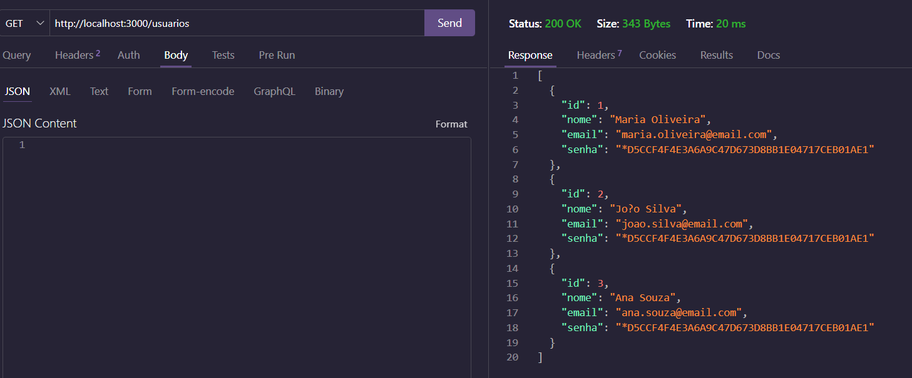
<h1>Listar Ocorrências</h1>
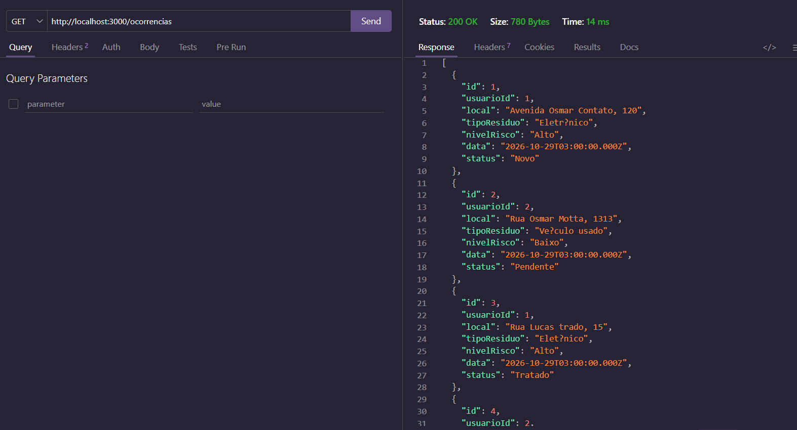
<h1>Resumo Ocorrências</h1>
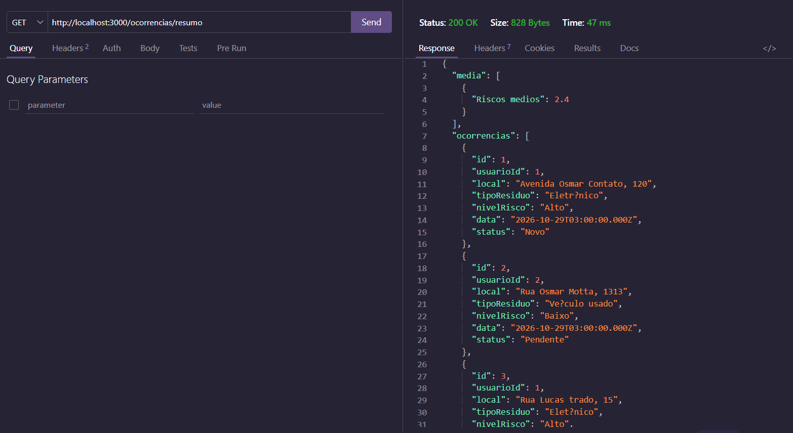
<h1>Alterar Usuários</h1>
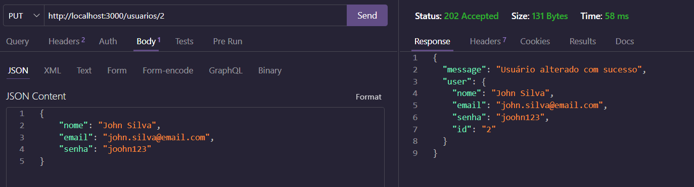
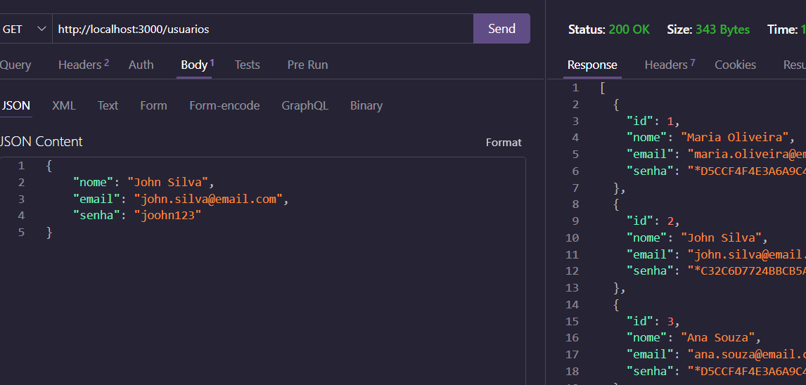
<h1>Alterar Ocorrências</h1>
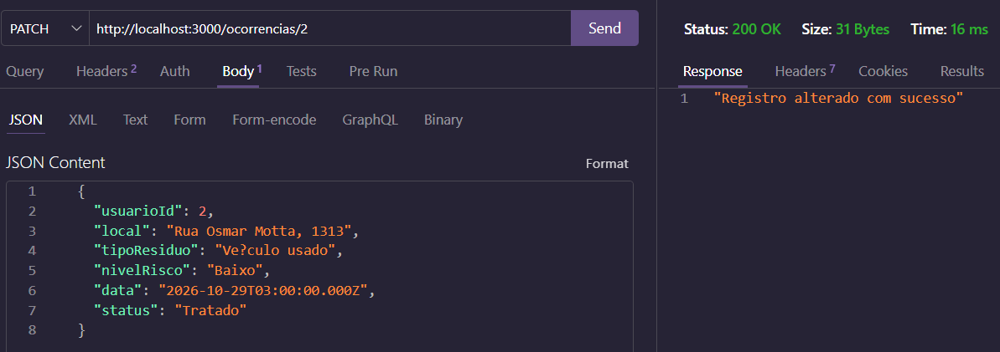
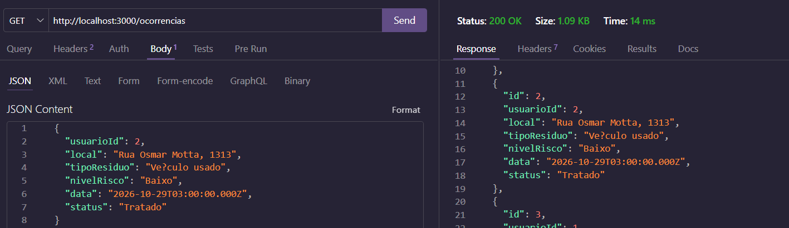
<h1>Excluir Usuários</h1>
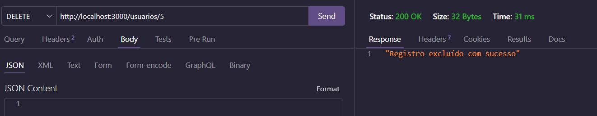
<h2>Se não apagar o evento correspondente ao usuário antes de tentar deletá-lo, irá dar o seguinte erro:</h2>
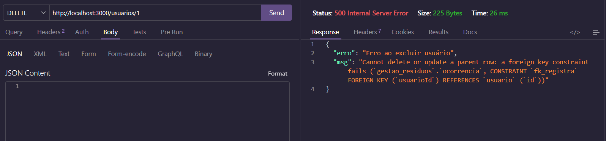
<h1>Excluir Ocorrências</h1>
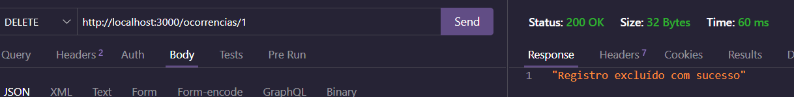
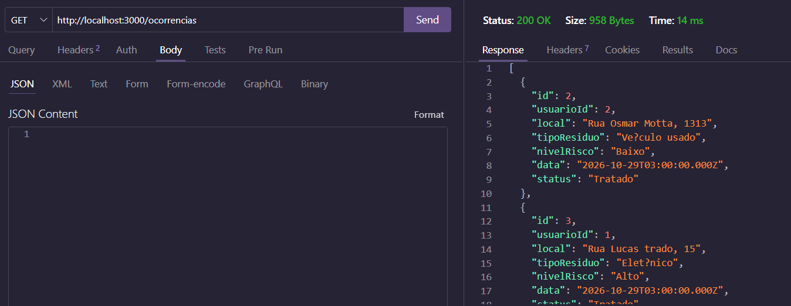

